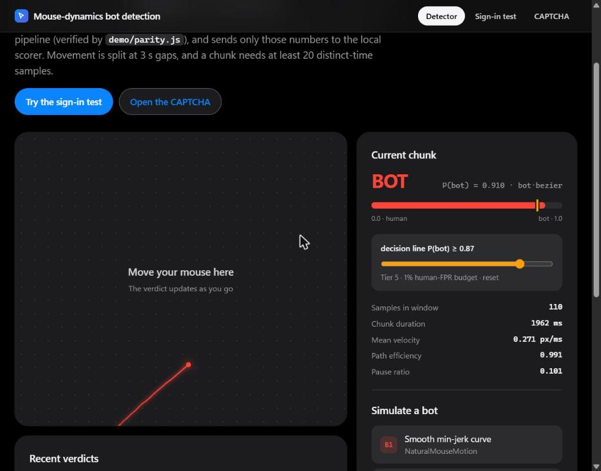

# Cross-domain mouse-dynamics bot detection

A mouse-movement bot detector (Random Forest, Java 17 / Weka) and an honest study of
where it breaks: out-of-domain transfer, feature-matched evasive bots, and a
seven-round attacker-versus-defender arms race. It comes with a live demo that has a
passive detector, a sign-in page judged by two independent checks, and a
sequential-reveal CAPTCHA.



## Run the demo

Requirements: JDK 17+, Maven dependencies resolved once (`mvn dependency:resolve`),
and the frozen model in `demo/model/` (see [`demo/README.md`](demo/README.md)).

**Windows:** double-click `run_demo.bat`, then open <http://127.0.0.1:8787/>.

**By hand:**

```
javac -cp "<weka>;<bounce>;<tablesaw>" -d target/classes src/main/java/*.java
java  -cp "target/classes;<weka>;<bounce>" DemoServer --oracle
```

| Page | What it shows |
| --- | --- |
| `/` Detector | Move the mouse for a live P(bot); four bot simulators; a movable decision threshold. |
| `/login.html` Sign-in test | A background mouse check plus a moving puzzle, combined by a decision table on the server. |
| `/challenge.html` CAPTCHA | One target revealed at a time, timed on the server's clock; four attack simulators. |

`--oracle` turns on the answer routes that the attack simulators need. Leave it off
anywhere other than a demo machine. The other server options and the security
behaviour are covered in [`demo/README.md`](demo/README.md#server-options).

Check the browser feature code against the Java pipeline with `node demo/parity.js`
(it must print `PARITY PASS`).

## Results

All figures, tables and caveats are in **[`CROSS_DOMAIN_STUDY.html`](CROSS_DOMAIN_STUDY.html)**,
the single canonical write-up. Several earlier figures were retracted after bug fixes
and re-baselines, so quote numbers from there only.

## Repository map

- [`PROJECT.md`](PROJECT.md) is the orientation index: build commands, every source
  file, which tool produces which result file, and open items.
- `src/main/java/` holds the pipeline, the evaluation tiers, the bot synthesizers and
  the demo server.
- `demo/` holds the front end, the frozen model and the probe scripts.
- `*_results.txt` are the raw outputs of each evaluation tool.

The datasets are not included. To re-run the evaluations, place DELBOT in
`delbot_data/` and the Balabit Mouse Dynamics Challenge in `balabit_data/`. The demo
only needs the frozen model in `demo/model/`.
